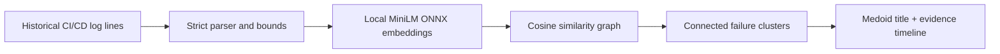

# Phantom Trace

Phantom Trace is a local incident-archaeology tool for CI/CD teams. It uses an
open-weight sentence-transformer to connect historical failures that mean the
same thing even when their exact wording changes, then shows every source event
behind each cluster.

It was started on October 26, 2026 for the DEV Hacktoberfest Week 4 challenge,
**Ghost in the Machine**. The sample data is fictional and contains no private
operational information.

## Why open AI is core

Keyword searches miss `x509 certificate has expired` when you search for
`TLS renewal failure`. Phantom Trace runs `all-MiniLM-L6-v2` locally with ONNX
Runtime to map each log message into a semantic vector. Those vectors—not a
remote service—drive the recurrence graph and cluster membership.

The application does not generate diagnoses. It selects a real medoid event as
the cluster title and preserves every supporting log line, so a human can audit
why events were connected. The haunting score is a transparent heuristic based
on recurrence, source breadth, and recency; it is not an AI confidence score.

## Run locally on Windows

```powershell
py -m venv .venv
.\.venv\Scripts\python.exe -m pip install -r requirements.txt
.\.venv\Scripts\python.exe setup_model.py
.\Start-PhantomTrace.ps1
```

Open <http://127.0.0.1:8766>. Model setup needs internet once; analysis does not.
Open <http://127.0.0.1:8766/?demo=1> to run the fictional sample automatically
for a repeatable demonstration or screenshot.

## Input format

One event per line:

```text
2026-10-01T09:04:12Z | deploy-api | TLS certificate expired while contacting artifact registry
```

The server accepts 2–200 events, bounds field sizes, and keeps inference inside
the local process. Do not paste secrets; logs should be redacted before any
diagnostic workflow, including this offline one.

The default similarity threshold is `0.55`. It was validated against the
included fictional sample, where it separates the TLS, disk-capacity, and
missing-secret incidents into three recurring clusters while leaving the
accessibility event isolated. Raise the slider when you prefer fewer, tighter
matches.

## Test

```powershell
.\.venv\Scripts\python.exe -m unittest discover -s tests -v
node --check static\app.js
```

Tests use deterministic fake vectors, so they do not require model downloads.

## Architecture



## Privacy and scope

- No analytics, cookies, accounts, or network calls during analysis.
- Model artifacts are pinned and downloaded separately.
- Results are diagnostic leads, not proven root causes.
- Semantic similarity can connect unrelated events or miss real recurrence;
  inspect the preserved evidence before acting.

## Attribution and new-work disclosure

The model is credited in [THIRD_PARTY_NOTICES.md](THIRD_PARTY_NOTICES.md).
The embedding runtime structure was informed by the author's earlier
MIT-licensed Steady Inbox project. Phantom Trace's incident model, clustering,
score, UI, tests, and documentation were created during the Week 4 entry period.

## License

MIT. See [LICENSE](LICENSE).
